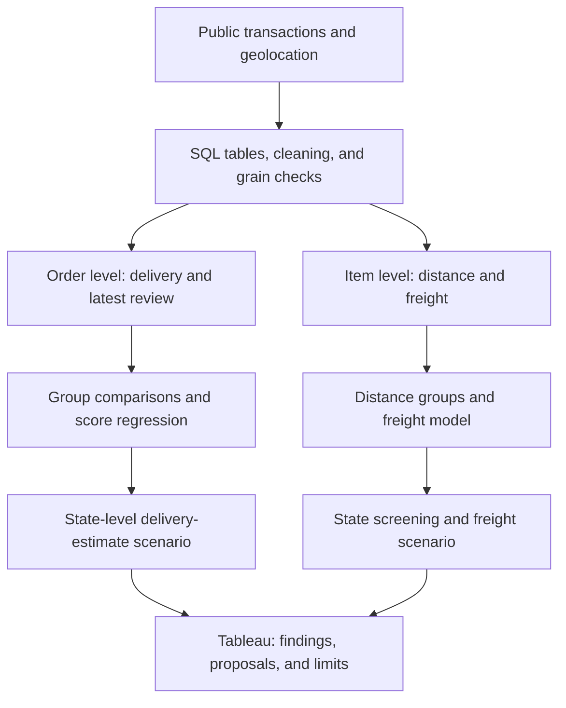
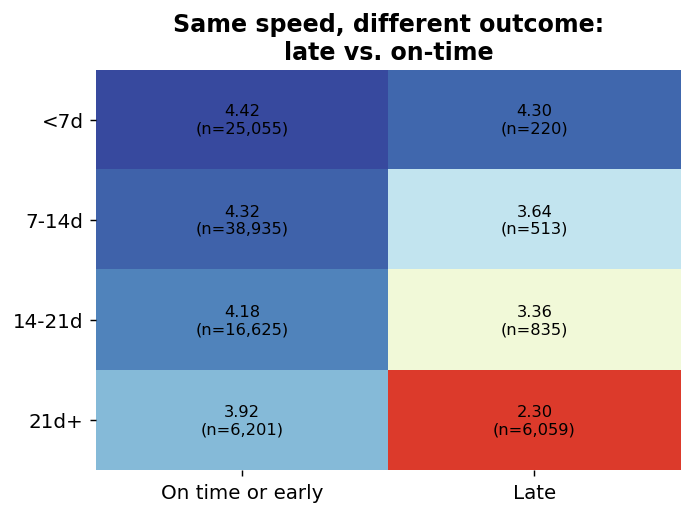
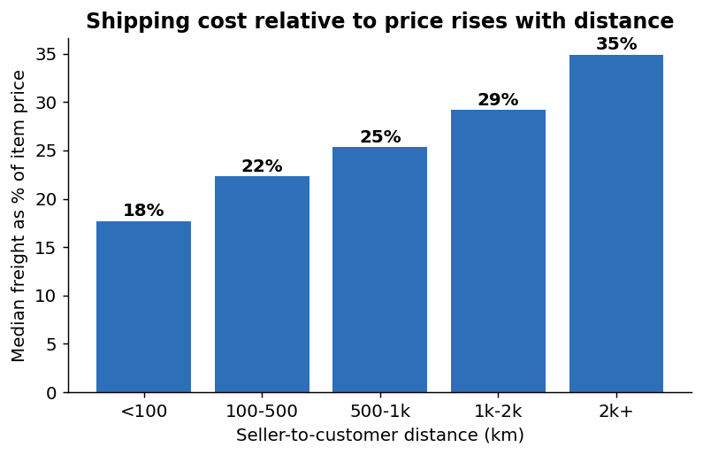

# Olist: Delivery Promises, Reviews, and Freight Costs

I used PostgreSQL, Python, and Tableau to analyze Olist's public e-commerce data from Brazil. I examined delivery duration, arrival relative to the estimated delivery timestamp, and freight costs across states. The aim was to turn a broad question about delivery experience into specific analyses and recommendations that could be tested.

> **Key result:** Across 94,443 reviewed orders, late arrivals averaged 2.56/5, compared with 4.29/5 for on-time or early arrivals.

[GitHub: code and analysis outputs](https://github.com/kellychiu00718/olist-brazilian-ecommerce-analysis) · [Tableau Public dashboard](https://public.tableau.com/views/LateordersgetlowerratingsonBrazilianE-commerceOlist_Whatstrategiesshouldbeapplied/1_1)

## 1. Problem Definition

How long an order takes to arrive and whether it arrives within the estimated time are different measures. Average delivery time alone can overlook how long the customer was told to expect. I wanted to understand **how review scores relate to delivery speed and to arriving later than estimated**.

The second question concerned freight costs. Does freight become a larger share of the item price as distance increases? Which states combine a high freight burden with enough observed purchases to warrant further investigation of logistics options?

I therefore organized the analysis around two questions: delivery and reviews, and distance and freight. The first informs a review of delivery estimates; the second narrows the states to investigate further.

## 2. My Role and Responsibilities

This was an independent analysis project. I defined the questions, wrote the SQL queries, checked joins and units of analysis, reviewed outputs, and developed the charts and recommendations. I also set the state-screening thresholds: a median freight-to-price ratio of at least 28% and at least 1,000 order-item records.

I used Python for statistical analysis and charts, then presented selected results in Tableau Public. Claude Code supported debugging; I was responsible for the questions, metric choices, and interpretation.

## 3. Data

The main source was the [Olist Brazilian E-Commerce Public Dataset](https://www.kaggle.com/datasets/olistbr/brazilian-ecommerce), covering orders, reviews, products, sellers, and geolocation from 2016–2018.

| Analytical dataset | Size | Preparation |
| --- | --- | --- |
| Orders and delivery | 99,441 source orders; 96,478 delivered, of which 95,082 passed the delivery-time cleaning rules | Excluded missing required timestamps and inconsistent event sequences |
| Delivery and reviews | 94,443 valid delivered orders with a review | 547 source orders had multiple reviews; retained the latest review per order before joining |
| Destination-state freight screening | 111,553 order-item records | Excluded canceled and unavailable orders; retained records with calculable distance and positive price |
| Freight model and distance groups | 111,119 order-item records | Further restricted the sample to positive distance, weight, and freight |

**Definitions:** Late means that the actual delivery timestamp is later than the estimated delivery timestamp. Freight burden means freight divided by item price. Distance is a straight-line estimate based on mean coordinates for each postal-code prefix, rather than the actual shipping route.

Raw data and order-level exports are excluded from GitHub. The repository contains SQL, Python, aggregate tables, and figures. The data license is CC BY-NC-SA 4.0; the code license is MIT.

## 4. Tools and Outputs

| Tool | Role and output |
| --- | --- |
| PostgreSQL | Table creation, quality checks, review deduplication, joins, and analytical views; exports for delivery, order items, and shipping corridors |
| Python: pandas, NumPy, statsmodels, SciPy, matplotlib | Group comparisons, regression with robust standard errors, state-level quantiles, and freight scenarios; statistical logs, aggregate CSVs, and figures |
| Tableau Public | An interactive presentation of arrival gaps, state-level delivery estimates, and freight screening |
| Claude Code | Debugging support |

## 5. Process

I checked data quality and granularity first, then built separate samples for the two questions. Observed results and scenario estimates were presented separately.



## 6. Key Findings

### 1. Late arrivals have lower scores within delivery-duration groups

Of the 94,443 reviewed orders, 7,627 were classified as late: 8.1% of the sample.

| Arrival status | Orders | Mean review score, out of 5 | Share rated 1–2 |
| --- | --- | --- | --- |
| On time or early | 86,816 | 4.29 | 9.2% |
| Late | 7,627 | 2.56 | 54.1% |

The difference remained within delivery-duration groups. Among orders taking at least 21 days, on-time orders averaged 3.92, compared with 2.30 for late orders. In a simple regression including total delivery days and a late indicator, the late coefficient was −1.22 points, with a 95% confidence interval of −1.27 to −1.17.



This supports reviewing the accuracy of delivery estimates as an operational metric. However, the model does not account for product or seller differences, and the data does not directly measure customers' feelings about a broken promise. The result is an association, not evidence of that causal explanation.

### 2. Early arrival overall can coexist with higher late rates in some states

In the reviewed-order sample, median delivery time was 10.3 days, compared with a median estimate of 23.2 days. Some 73.8% arrived at least 7 days early. Yet 79.4% of late orders took at least 21 days to arrive.

I compared each state's historical 91.8th percentile of delivery duration with its median estimated duration:

| State | Median estimated duration | Historical 91.8th-percentile delivery duration |
| --- | --- | --- |
| Rio de Janeiro (RJ) | 24.6 days | 31.7 days |
| São Paulo (SP) | 18.9 days | 17.0 days |

This is a historical scenario using roughly 91.8% delivery coverage as a common benchmark, not a validated replacement policy. It highlights the need to examine states separately. A next step would be to test state- or route-level estimates while tracking late rates, reviews, and purchase conversion, so that simply extending estimates is not treated as an improvement.

### 3. Longer-distance items carry a higher freight burden relative to price

Among the 111,119 order-item records used for the freight analysis, the median freight-to-price ratio was 17.7% below 100 km and 34.9% beyond 2,000 km. A log-freight model including item weight and price had a distance-term coefficient of about 0.19 and an R² of 0.512.



This gave the screening a direction: consider distance, freight burden, and observed purchases together. The model describes an association and does not, by itself, establish where a warehouse should be located.

### 4. Five states warrant further investigation; the savings estimate is a separate scenario

Applying my thresholds of at least 28% median freight-to-price ratio and 1,000 order-item records to the 111,553-record destination-state sample produced five candidates:

| Candidate state | Order-item records | Median freight-to-price ratio |
| --- | --- | --- |
| Bahia (BA) | 3,763 | 29.5% |
| Pernambuco (PE) | 1,796 | 32.8% |
| Ceará (CE) | 1,464 | 32.4% |
| Pará (PA) | 1,076 | 34.8% |
| Mato Grosso (MT) | 1,048 | 29.0% |

About 71–77% of items sent to these states came from São Paulo sellers, making cross-state supply a direction to investigate. These are screening thresholds I chose, not optimized warehouse criteria. Observed order-item counts do not measure total demand or purchase conversion.

Separately, within the freight-model sample, 10,003 items nationwide traveled more than 1,500 km. If their freight were adjusted to the model's 1,000 km distance level, the estimated reduction would be about **R$48,003**: roughly 13% of freight for those distant items and 2.2% of freight across the full model sample.

**This is not an estimate of the benefit of opening hubs in the five candidate states.** It excludes rent, inventory, upstream transportation, and handling costs. It can inform further costing and a small pilot, but it does not establish net savings.

[Statistical outputs](outputs/stats.txt) · [Destination-state screening table](outputs/tableau/3b_destination_states.csv)

## 7. Challenges and Lessons

- **Check what one row represents before joining tables.** Reviews were not one row per order, so a direct join duplicated orders. I first kept the latest review per order, then built the order-level delivery analysis. Freight remained at order-item level, with its samples and denominators stated separately.
- **Make metric definitions inspectable.** This version uses timestamps to classify lateness and mean postal-code coordinates to estimate distance. Operational use would require confirming whether an estimated delivery date means the end of that day, then checking how alternative lateness definitions and distance estimates affect the results.
- **Match the recommendation to what the data supports.** The review gap motivates examining delivery estimates; state screening and freight scenarios provide a starting point for costing. Historical public data does not show that these changes would raise ratings, increase orders, or produce net savings. Those outcomes require further testing.

<details>
<summary>Additional exploration and code</summary>

The repository also contains seller-acquisition funnel and listing-length analyses, using the additional [Marketing Funnel by Olist dataset](https://www.kaggle.com/datasets/olistbr/marketing-funnel-olist) where relevant. They address separate decisions and are outside this case study's main narrative. The funnel describes seller acquisition, not shopper conversion; seller-performance queries do not yet use a consistent post-deal observation window. The listing analysis covers products with observed sales and lacks exposure data, so it cannot establish whether longer descriptions increase sales.
[Seller funnel SQL](sql/04_funnel_to_seller_quality.sql) · [Listing-content SQL](sql/05_listing_content.sql) · [Python analysis](python/analysis.py)

</details>

## Reproducing the Analysis

The SQL setup files create empty tables; they do not import the CSVs. A full rerun requires both public datasets because `python/analysis.py` executes the delivery, freight, funnel, and listing analyses together.

1. Download the [e-commerce dataset](https://www.kaggle.com/datasets/olistbr/brazilian-ecommerce) and [marketing-funnel dataset](https://www.kaggle.com/datasets/olistbr/marketing-funnel-olist). Keep the raw CSVs locally, for example under `orders/` and `marketing_funnel/`.
2. Create a PostgreSQL database named `olist` and run the two table-creation scripts:

   ```bash
   psql -v ON_ERROR_STOP=1 -d olist -f sql/00_create_tables.sql
   psql -v ON_ERROR_STOP=1 -d olist -f sql/00_create_funnel_tables.sql
   ```

3. Import the CSVs into the matching tables in the `olist` schema, using pgAdmin or `psql` copy commands. The mapping is below. Check the row counts against the comments in the setup scripts.

   | Source CSV | Destination table |
   | --- | --- |
   | `olist_customers_dataset.csv` | `olist.customers` |
   | `olist_sellers_dataset.csv` | `olist.sellers` |
   | `olist_products_dataset.csv` | `olist.products` |
   | `product_category_name_translation.csv` | `olist.product_category_translation` |
   | `olist_orders_dataset.csv` | `olist.orders` |
   | `olist_order_items_dataset.csv` | `olist.order_items` |
   | `olist_order_payments_dataset.csv` | `olist.order_payments` |
   | `olist_order_reviews_dataset.csv` | `olist.order_reviews` |
   | `olist_geolocation_dataset.csv` | `olist.geolocation` |
   | `olist_marketing_qualified_leads_dataset.csv` | `olist.marketing_qualified_leads` |
   | `olist_closed_deals_dataset.csv` | `olist.closed_deals` |

4. From the repository root, create the output folders and run SQL files 01–07 in order. Files 06 and 07 export the row-level CSVs consumed by Python; these stay local.

   ```bash
   mkdir -p data outputs figures outputs/tableau
   for script in sql/0[1-7]_*.sql; do
     psql -v ON_ERROR_STOP=1 -d olist -f "$script" || break
   done
   ```

5. In a Python environment with `numpy`, `pandas`, `matplotlib`, `statsmodels`, and `scipy`, run:

   ```bash
   python3 python/analysis.py
   python3 python/background.py
   python3 python/make_tableau_extracts.py
   ```

   `analysis.py` writes the statistical log, summary tables, and eight figures. `background.py` adds two background figures and the long-tail summary. `make_tableau_extracts.py` writes six aggregate CSVs under `outputs/tableau/`.

Published results can be inspected without the raw data in [outputs/stats.txt](outputs/stats.txt), [outputs/long_tail.txt](outputs/long_tail.txt), and [outputs/tableau/](outputs/tableau/). Regenerating the regressions requires the local row-level exports.

## Attribution

Independent analysis by Meng-Yu (Kelly) Chiu. Claude Code assisted with debugging; this README and the portfolio narrative were edited with AI assistance.

Data: Olist, CC BY-NC-SA 4.0. Derived aggregate tables and figures retain that license. Code: MIT; see [LICENSE](LICENSE). No business intervention or measured implementation outcome is claimed.
