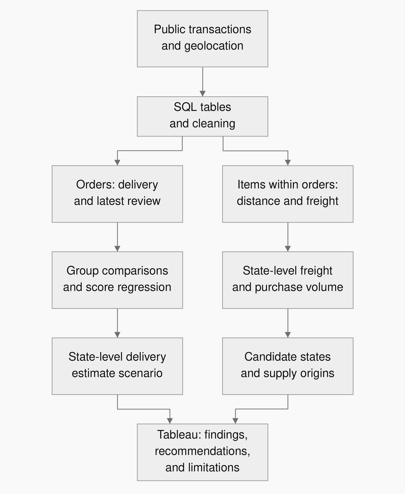
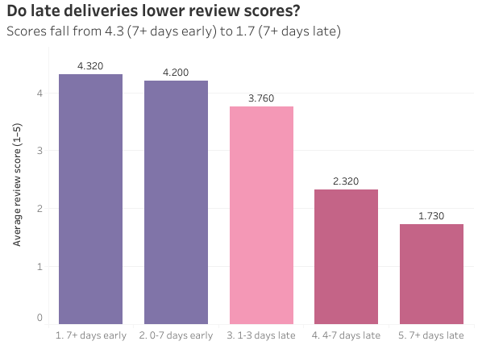
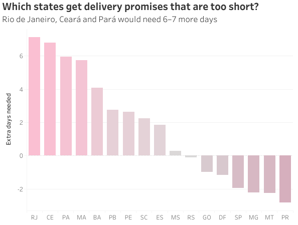
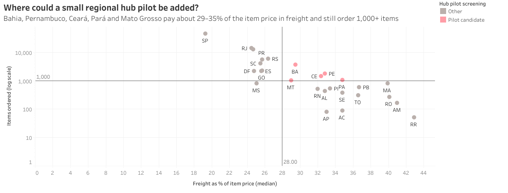

# Late Orders Get Lower Ratings On Brazilian E-commerce (Olist). What Strategies Should Be Applied?

**Olist E-commerce Order Data Analysis:**<br>I used PostgreSQL, Python, and Tableau to analyze Olist's public e-commerce data from Brazil, focusing on two questions:<br>1. **How do delivery speed and the estimated arrival time each relate to buyer ratings?<br>2. Which states have relatively high freight charges but still a substantial volume of item purchases, making them a priority for assessing logistics improvements?**<br>The aim was to **improve the delivery experience** and develop recommendations for marketplace operations.

> **Initial observation**: Across 94,443 reviewed orders, late arrivals averaged 2.56/5, compared with 4.29/5 for on-time or early arrivals.

[GitHub: code and analysis](https://github.com/kellychiu00718/olist-brazilian-ecommerce-analysis) · [Tableau Public dashboard](https://public.tableau.com/views/LateordersgetlowerratingsonBrazilianE-commerceOlist_Whatstrategiesshouldbeapplied/1_1)

## 1. Problem Definition

**How long customers wait between placing an order and receiving it** and **whether an item arrives within the time promised or estimated by the seller** involve different customer expectations. Looking only at average delivery time, without considering what the marketplace or seller originally told customers to expect, may overlook an important part of the relationship between low ratings and delivery speed.<br />I therefore wanted to understand: **How do low review scores relate to 1. delivery speed** and **2. arrival after the promised time?**

The other question I wanted to explore was **freight burden and priorities for logistics improvements**. Which states have relatively high freight charges compared with item prices, yet still a substantial volume of item purchases? Where are the items purchased in these states supplied from, and is it worth assessing small logistics hubs?

Across both questions, the aim was to **improve the marketplace's delivery experience and benefit both the marketplace and its sellers**.

## 2. My Role and Responsibilities

This was a personal analysis project, primarily intended to help me practice writing SQL queries. Claude Code played a supporting role when I needed help with a query, while **I was responsible for defining the questions, writing SQL queries, turning statistical results into Tableau charts, and developing actionable recommendations**.

## 3. Data

The main source was the [Olist Brazilian E-Commerce Public Dataset](https://www.kaggle.com/datasets/olistbr/brazilian-ecommerce), covering orders, reviews, products, sellers, and geolocation from 2016–2018.

The freight analysis uses one record per item within an order. An order containing several items therefore contributes several order-item records. For example, an order containing a shirt and a cup counts as one order and two order-item records.

| Analytical dataset | Size | Preparation |
| --- | --- | --- |
| Orders and delivery | 99,441 source orders; 96,478 were delivered, of which 95,082 passed data cleaning | Excluded missing timestamps and inconsistent event sequences |
| Delivery and reviews | 94,443 valid delivered orders with a review | 547 orders had multiple reviews; retained the latest review per order before joining delivery data |
| Destination-state freight screening | 111,553 order-item records | Excluded canceled and unavailable orders; retained records with calculable distance and positive price |
| Freight model and distance groups | 111,119 order-item records | Further restricted the sample to positive distance, weight, and freight |

**Metric definitions:**<br />Late = arrival later than the originally estimated time.<br />Freight-to-price ratio = freight / item price.<br />Distance = the estimated straight-line distance between the mean coordinates of the seller's and buyer's postal-code prefixes, rather than the actual shipping route.

## 4. Tools and Outputs

| Tool | Role and output |
| --- | --- |
| PostgreSQL | Table creation, quality checks, review deduplication, joins, and analytical views; exports for delivery, order items, and shipping corridors |
| Python: pandas, NumPy, statsmodels, SciPy, matplotlib | Group comparisons, regression with robust standard errors, state-level quantiles, and freight scenarios; statistical logs, aggregate CSVs, and charts |
| Tableau Public | An interactive dashboard presenting the analysis results |
| Claude Code | Support with writing and debugging queries |

## 5. Process



## 6. Key Findings

### ① Review scores differ by arrival relative to the estimate, as well as delivery speed

Of the 94,443 reviewed orders, 7,627 were classified as late: 8.1% of the sample.

| Arrival status | Orders | Mean review score, out of 5 | Share rated 1–2 |
| --- | --- | --- | --- |
| On time or early | 86,816 | **4.29** | 9.2% |
| Late | 7,627 | **2.56** | **54.1%** |

Comparing orders by delivery duration showed that, among those taking at least 21 days, on-time arrivals averaged 3.92, while late arrivals averaged 2.30.<br />In a simple regression including total delivery days and a late indicator, the late coefficient was −1.22 points, with a 95% confidence interval of −1.27 to −1.17.<br />This supports including **the accuracy of delivery estimates** in an operational review. However, the model does not yet account for differences between products or marketplace sellers, and the data does not directly measure customers' feelings. It therefore cannot establish that a broken promise caused the lower ratings.




[Open this chart in Tableau](https://public.tableau.com/views/LateordersgetlowerratingsonBrazilianE-commerceOlist_Whatstrategiesshouldbeapplied/1?:showVizHome=no). It compares average order ratings across arrival-gap groups.

### ② Early arrival overall does not eliminate the risk of delays in some states

Within the reviewed-order sample, median delivery time was 10.3 days and median estimated delivery time was 23.2 days. Some 73.8% of orders arrived at least 7 days early, but 79.4% of late orders took at least 21 days to arrive.

I compared the historical 91.8th percentile of delivery duration in each state—a common scenario covering roughly 91.8% of deliveries—with the state's median estimated duration. The table shows the five highest late rates among states with at least 500 reviewed orders, plus São Paulo as a reference.

| State | Reviewed orders | Late rate | Median estimate (days) | 91.8% benchmark (days) | Scenario change (days) |
| --- | --- | --- | --- | --- | --- |
| Maranhão (MA) | 699 | 19.60% | 30.2 | 36.0 | +5.8 |
| Ceará (CE) | 1,253 | 15.48% | 31.3 | 38.0 | +6.8 |
| Bahia (BA) | 3,183 | 13.76% | 29.0 | 33.1 | +4.1 |
| Rio de Janeiro (RJ) | 12,072 | 13.41% | 24.6 | 31.7 | +7.1 |
| Espírito Santo (ES) | 1,942 | 11.95% | 25.0 | 26.9 | +1.8 |
| São Paulo (SP) | 39,677 | 5.89% | 18.9 | 17.0 | −1.9 |

The table is ranked by late rate; São Paulo is a reference. [See all 17 states](outputs/tableau/2_promise_by_state.csv).

A high late rate does not necessarily mean a state should receive the highest priority for improvement. Maranhão has the highest late rate, 19.60%, across 699 reviewed orders, while Rio de Janeiro has a 13.41% rate across 12,072. Decisions about improving the delivery experience therefore need to consider both the late rate and the volume of affected orders.



[Open this chart in Tableau](https://public.tableau.com/views/LateordersgetlowerratingsonBrazilianE-commerceOlist_Whatstrategiesshouldbeapplied/2?:showVizHome=no).<br>Note: the chart is ranked by the adjustment in days to the estimated arrival time, rather than by late rate as in the table above.<br>A positive value indicates that the estimate would need to allow more time; it is not the average number of days an order arrived late.

These results suggest that some states may need revised delivery estimates to avoid setting unrealistic expectations.

### ③ Five states warrant further assessment for logistics improvements

Before comparing states, I examined how freight burden varied with distance: the median freight-to-price ratio was 17.7% below 100 km and 34.9% beyond 2,000 km.

I then screened 111,553 order-item records using two initial criteria: **a median freight-to-price ratio of at least 28% and at least 1,000 order-item records**. I chose these thresholds to consider both freight burden and observed purchase volume; they were not derived from the distance-group results. The following states met both criteria.

| Candidate state | Order-item records | Median freight-to-price ratio |
| --- | --- | --- |
| Bahia (BA) | 3,763 | 29.5% |
| Pernambuco (PE) | 1,796 | 32.8% |
| Ceará (CE) | 1,464 | 32.4% |
| Pará (PA) | 1,076 | 34.8% |
| Mato Grosso (MT) | 1,048 | 29.0% |



[Open this chart in Tableau](https://public.tableau.com/views/LateordersgetlowerratingsonBrazilianE-commerceOlist_Whatstrategiesshouldbeapplied/5?:showVizHome=no). Pink points meet both screening thresholds. The vertical axis shows order-item counts on a log scale; the horizontal axis shows the median freight-to-price ratio.

Notably, **about 71–77% of the order-item records for these five states came from sellers in São Paulo**. These states combine a relatively high freight burden with a substantial volume of purchases and a concentration of supply from outside the state. They therefore warrant further assessment of whether small logistics hubs could improve delivery conditions. Deciding whether to open a hub would also require estimates of warehousing, inventory, and transportation costs.

[Candidate-state summary](outputs/tableau/3b_destination_states.csv)

<details>
<summary>Supplement: Freight Scenario</summary>

I also used the freight model to explore how much lower freight charges could save on long-distance deliveries. This scenario used the nationwide model sample, rather than only the five candidate states.

I selected order-item records with delivery distances over 1,500 km, then assumed those distances fell to 1,000 km. The model estimated the change in freight charges while holding item weight and price constant. **The 1,500 km cutoff and 1,000 km comparison distance were assumptions chosen for this scenario; I have not verified whether logistics hubs could achieve them.** These distances were not derived from the 28% and 1,000-record criteria used to screen states.

The distance filter returned 10,003 order-item records; this was the resulting count, rather than a sample size set in advance. Estimated freight charges fell by about **R\$48,003**, or 13% of the original freight for these long-distance items and 2.2% of total freight across all records used in the model.

**This is a hypothetical scenario, not an estimate of the benefit of opening hubs in the five candidate states.** The model does not yet include rent, inventory, additional transportation, or handling costs. Assessing a hub would require comparing different distance assumptions and recalculating the results using actual candidate locations and additional costs.

[Distance-group chart](figures/b1_freight_ratio_by_distance.png) · [Freight model and scenario code](python/analysis.py#L113) · [Statistical outputs](outputs/stats.txt)

Model details: the log-freight regression includes distance, item weight, and item price, with robust standard errors. The distance-term coefficient is about 0.19 and R² is 0.512. The scenario applies the estimated distance adjustment to each item's observed freight charge.

</details>

## 7. Challenges and Lessons

- **Before joining tables, clarify what each row represents.** At the start, I joined the tables without checking that the review table could contain more than one row per order, which duplicated order counts. I only noticed the mistake when Claude Code reviewed my query. I then re-examined what each row represented, kept the latest review as the final score for orders with multiple reviews, and restarted the order-level analysis. This made me realize that, although defining the problem comes first, a valid analysis also depends on understanding what each column and row represents and choosing the right level of analysis for the question.

## Reproducing the Analysis

The SQL setup files create empty tables; they do not import the CSVs. A full rerun requires both public datasets because `python/analysis.py` executes the delivery, freight, funnel, and listing analyses together.

1. Download the [e-commerce dataset](https://www.kaggle.com/datasets/olistbr/brazilian-ecommerce) and [marketing-funnel dataset](https://www.kaggle.com/datasets/olistbr/marketing-funnel-olist). Keep the raw CSVs locally, for example under `orders/` and `marketing_funnel/`.
2. Create a PostgreSQL database named `olist` and run the two table-creation scripts:

   ```bash
   psql -v ON_ERROR_STOP=1 -d olist -f sql/00_create_tables.sql
   psql -v ON_ERROR_STOP=1 -d olist -f sql/00_create_funnel_tables.sql
   ```

3. Import the CSVs into the matching tables in the `olist` schema, using pgAdmin or `psql` copy commands. The mapping is below. Check the row counts against the comments in the setup scripts.

   | Source CSV | Destination table |
   | --- | --- |
   | `olist_customers_dataset.csv` | `olist.customers` |
   | `olist_sellers_dataset.csv` | `olist.sellers` |
   | `olist_products_dataset.csv` | `olist.products` |
   | `product_category_name_translation.csv` | `olist.product_category_translation` |
   | `olist_orders_dataset.csv` | `olist.orders` |
   | `olist_order_items_dataset.csv` | `olist.order_items` |
   | `olist_order_payments_dataset.csv` | `olist.order_payments` |
   | `olist_order_reviews_dataset.csv` | `olist.order_reviews` |
   | `olist_geolocation_dataset.csv` | `olist.geolocation` |
   | `olist_marketing_qualified_leads_dataset.csv` | `olist.marketing_qualified_leads` |
   | `olist_closed_deals_dataset.csv` | `olist.closed_deals` |

4. From the repository root, create the output folders and run SQL files 01–07 in order. Files 06 and 07 export the row-level CSVs consumed by Python; these stay local.

   ```bash
   mkdir -p data outputs figures outputs/tableau
   for script in sql/0[1-7]_*.sql; do
     psql -v ON_ERROR_STOP=1 -d olist -f "$script" || break
   done
   ```

5. In a Python environment with `numpy`, `pandas`, `matplotlib`, `statsmodels`, and `scipy`, run:

   ```bash
   python3 python/analysis.py
   python3 python/background.py
   python3 python/make_tableau_extracts.py
   ```

   `analysis.py` writes the statistical log, summary tables, and eight figures. `background.py` adds two background figures and the long-tail summary. `make_tableau_extracts.py` writes six aggregate CSVs under `outputs/tableau/`.

Published results can be inspected without the raw data in [outputs/stats.txt](outputs/stats.txt), [outputs/long_tail.txt](outputs/long_tail.txt), and [outputs/tableau/](outputs/tableau/). Regenerating the regressions requires the local row-level exports.

## Attribution

Independent analysis by Meng-Yu (Kelly) Chiu. Claude Code assisted with query writing, review, and debugging; this README and the portfolio narrative were edited with AI assistance.

Data: Olist, CC BY-NC-SA 4.0. Derived aggregate tables and figures retain that license. Code: MIT; see [LICENSE](LICENSE). No business intervention or measured implementation outcome is claimed.

